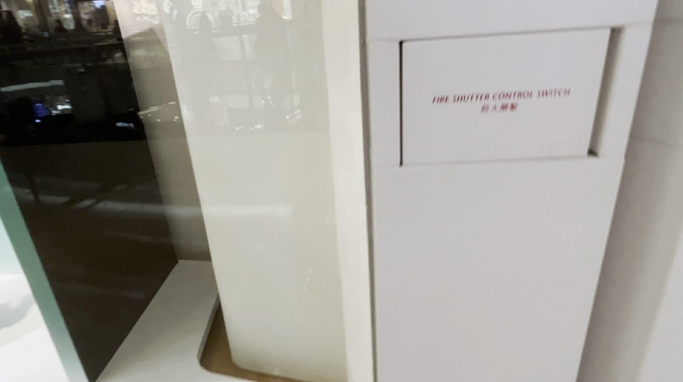
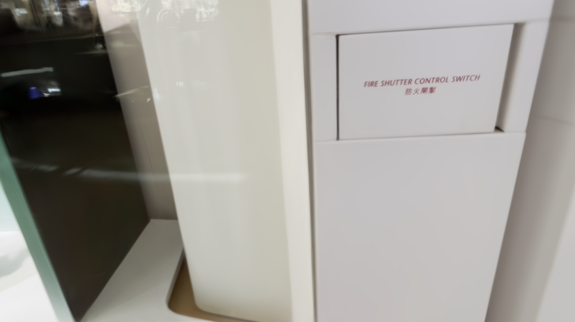
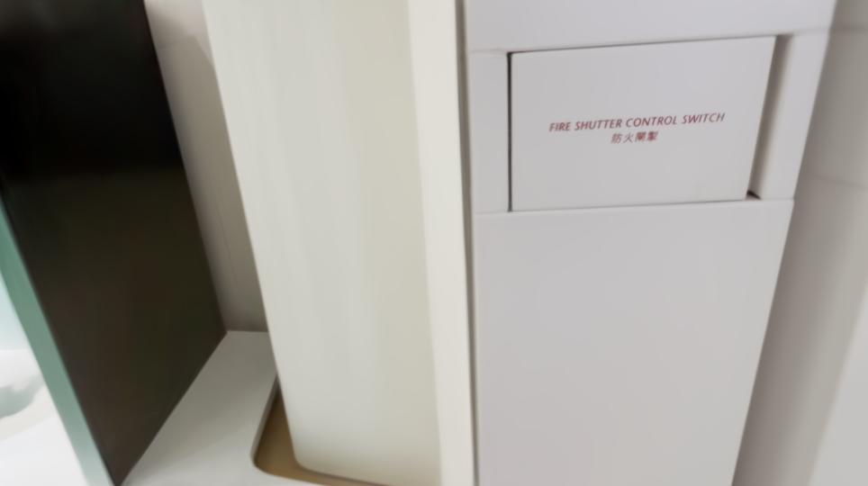
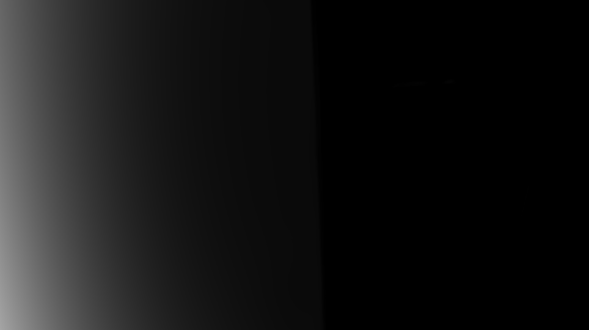
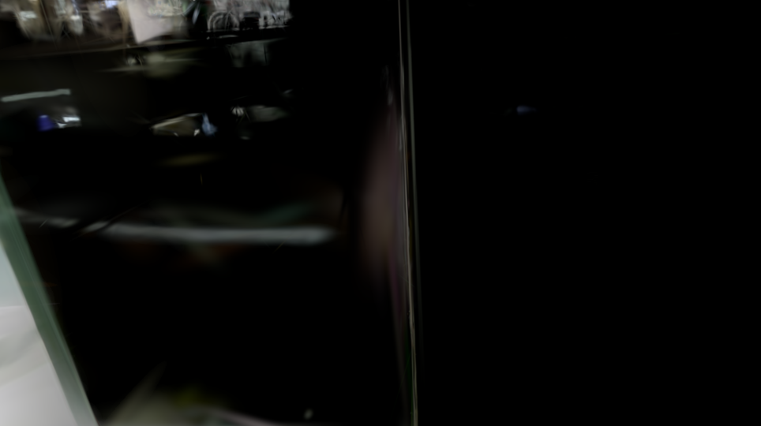
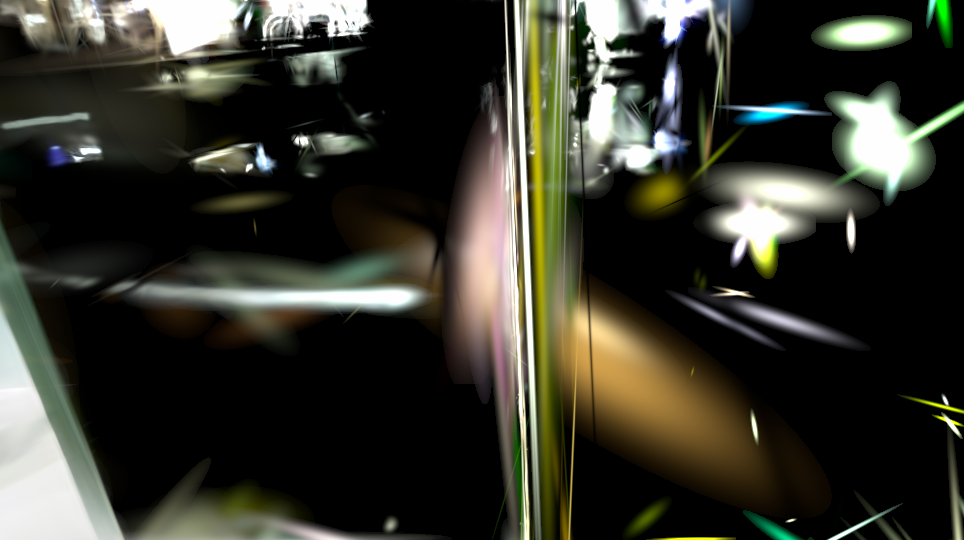
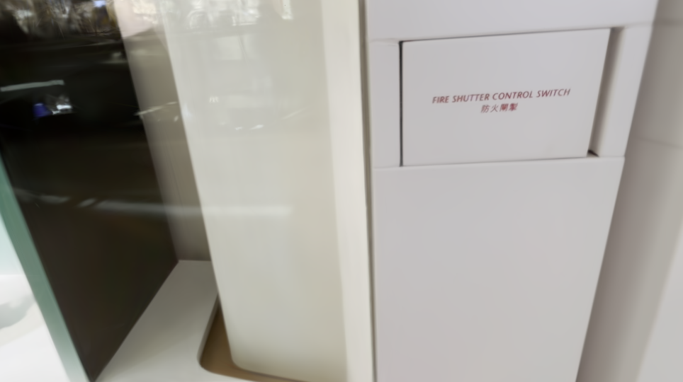
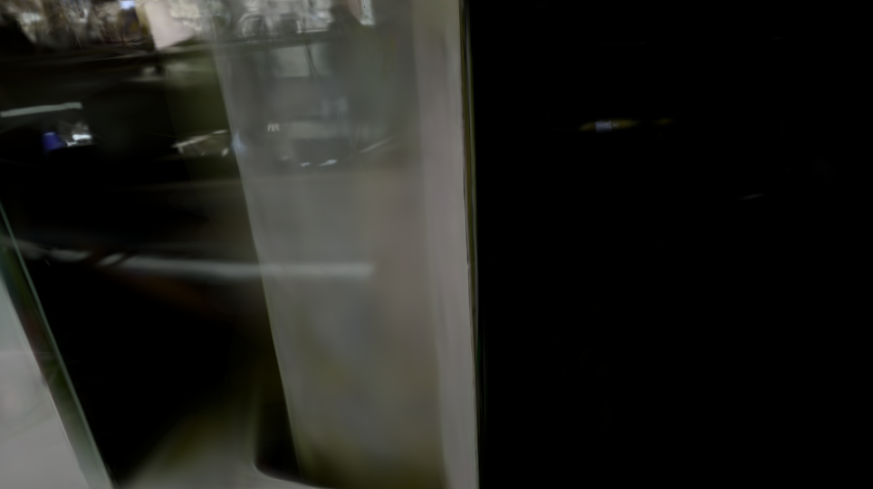

# VSGD 0758: Analysis of the full model and five ablations

Run: Colab, 2026-11-18, branch `viet_huynh`, notebook `notebooks/colab_vsgd_0758.ipynb`.
The raw results are on Drive under `vigor_gs_runs/VSGD_0758/`. Extracted numbers and figures are in `data/` and `figures/`.

---

## 0. Summary

1. **The full model reaches 33.09 dB PSNR (sRGB) on 29 test views, but it does not top the table.** Two ablations beat it:
   - `no_separation` (one field trained directly on the original images): 34.44 dB, better than `full` on 28/29 views.
   - `no_fresnel` (α is one learned constant): 34.12 dB, better than `full` on 28/29 views.

   On composite-image PSNR/SSIM/LPIPS alone, the current ablation table does **not** support the "separate reflection field" component or the "Fresnel" component.
2. **The virtual camera is the clearest contributor.** Removing it costs 2.88 dB and loses on all 29/29 views, and the loss grows towards the end of the sequence.
3. **The p·o factorization helps, but through geometry, not appearance.** Without it, Phase I PSNR is even higher (33.21 vs 32.59), but the glass points smear out to z = 72. The fitted plane is 44° off the one from `full` and has only 8% inliers. The final result is 1.04 dB worse and loses on 27/29 views.
4. **The single-plane glass assumption is violated in 0758.** The glass points lie on at least 3 plane orientations, 67–74° apart. The chosen plane holds only 17.7% of the points, and 4% of the cameras are on the wrong side of it. This is the most likely reason Fresnel and the virtual camera do not reach their potential.
5. **The Schlick α is too small for the data.** `no_fresnel` learns α = 0.242, about 6× the Schlick F0 = 0.04 (η = 1.5). In `full`, 51% of the glass pixels have α < 0.1. The price `no_fresnel` pays is that its reflection layer **contains transmitted content** (figure 3): higher PSNR, worse separation.
6. **`shared_field` is a degenerate ablation as currently built.** It runs 0 iterations, falls from 27 dB on the first view to 16 dB on the last, and is worse than adding no reflection at all. It should not go in a results table until it is redesigned.
7. **Separation metrics are needed** (transmission vs clean image, leakage between layers). Without them the table will always favour the single-field baseline, because that baseline directly optimises the quantity being measured.

---

## 1. Setup

| Item | Value |
|---|---|
| Scene | VSGD `0758`: 146 frames, 117 train / 29 test (`split.json`) |
| Images | `colmap/images`, `-r 2` giving 964×540; masks and clean images undistorted into COLMAP coordinates (< 0.25 px residual) |
| Phase I | 30 000 iterations, 256×8 deformation MLP, `--eval` |
| Phase II | 30 000 iterations, G_R initialised with 100 000 points |
| Colour space | `linear_rgb=True` (default); η_air = 1.0, η_glass = 1.5 |
| `optical_correction` (h_ψ) | **Off** (default), so α in `full` is pure Schlick |
| Glass plane | RANSAC on G_I (no `--glass_plane`) |
| Seeds | One run per variant |

Wall-clock time on the Colab GPU:

| Step | full | no_factorization | no_separation | no_virtual_camera | no_fresnel | shared_field |
|---|---|---|---|---|---|---|
| Phase I | 34 min | 41 min | 35 min | (reuses full) | (reuses full) | (reuses full) |
| Phase II | 15 min | 10.5 min | – | 16.5 min | 15.5 min | < 1 min (0 iterations) |

The total was about 3 h 05 min, including the `extract_plane` JSON crash and its re-run (fixed in commit `e20d954`).

`no_virtual_camera`, `no_fresnel` and `shared_field` reuse the Phase I model and glass plane of `full`. Their differences from `full` therefore come from Phase II only, which makes them clean comparisons.

---

## 2. Main results

The numbers come from `metrics.py` on the 8-bit sRGB PNGs of the 29 test views. Δ is the paired per-view PSNR difference from `full`, averaged. "Wins" counts the views where the variant has higher PSNR than `full`.

| Variant | PSNR ↑ | SSIM ↑ | LPIPS ↓ | M-PSNR ↑ | M-SSIM ↑ | M-LPIPS ↓ | Δ PSNR | wins | p (Wilcoxon) |
|---|---|---|---|---|---|---|---|---|---|
| **full** | 33.09 | 0.9390 | 0.2109 | 34.24 | 0.9690 | 0.0961 | – | – | – |
| (1) no_factorization | 32.05 | 0.9404 | 0.2041 | 32.71 | 0.9679 | 0.0967 | −1.04 | 2/29 | 6e-7 |
| (2a) no_separation | **34.44** | **0.9439** | **0.2001** | **35.62** | 0.9697 | 0.0958 | **+1.35** | 28/29 | 4e-6 |
| (2b) shared_field | 24.52 | 0.8928 | 0.2575 | 24.77 | 0.9231 | 0.1426 | −8.56 | 0/29 | 4e-9 |
| (3) no_virtual_camera | 30.21 | 0.9213 | 0.2423 | 30.82 | 0.9513 | 0.1274 | −2.88 | 0/29 | 4e-9 |
| (4) no_fresnel | 34.12 | 0.9406 | 0.2060 | 35.55 | **0.9706** | **0.0915** | +1.03 | 28/29 | 3e-6 |

PSNR ranking: `no_separation` > `no_fresnel` > **`full`** > `no_factorization` > `no_virtual_camera` >> `shared_field`.

One detail: on full-image SSIM and LPIPS, `no_factorization` is also marginally better than `full` (0.9404 vs 0.9390, 0.204 vs 0.211), even though its PSNR is 1 dB lower. The difference is small and probably comes from non-glass regions.

### 2.1 Caveats when reading the numbers

**(a) The PSNR in the training log and the PSNR from `metrics.py` are different quantities.** The `train_reflection.py` log computes PSNR in *linear RGB* (because `linear_rgb=True`), while `metrics.py` uses the *sRGB* PNGs. The two therefore differ by 0.2–1 dB, sometimes in opposite directions:

| | full | no_fact | no_vc | no_fresnel | shared |
|---|---|---|---|---|---|
| Training log (linear) | 32.26 | 31.13 | 29.40 | 33.58 | 25.53 |
| metrics.py (sRGB) | 33.09 | 32.05 | 30.21 | 34.12 | 24.52 |

The paper should report the sRGB `metrics.py` numbers and say which colour space they are in.

**(b) "Masked" PSNR/SSIM/LPIPS are not computed inside the glass region only.** `metrics.py` multiplies both the render and the GT by the mask and then evaluates over **the whole image**. Pixels outside the mask are zero in both images, so the MSE is spread over those pixels too, and M-PSNR is inflated by about `10·log10(1/mask fraction)`. The glass covers about 54% of view 26, which corresponds to roughly +2.7 dB.

From M-PSNR and PSNR one can recover **the share of the error that lies inside the glass**: 77% for `full`, 73% for `no_fresnel`, 87% for `no_virtual_camera` and 95% for `shared_field`. Most of the error is in the glass, as expected.

A proper region PSNR (MSE averaged over the mask pixels only) should be added so the results compare with other papers.

**(c) Statistical confidence.** The whole table rests on one scene and one seed. The 29 test views come from one video sequence, so they are not independent, and the Wilcoxon p-values are indicative only. Still, splits such as 28/29 or 0/29 views are very consistent, so the **direction** of each result is reliable. The exact size of each Δ needs more seeds and more scenes.

---

## 3. Per-variant analysis

### 3.1 Full model (`full`)

**Phase I is in good shape:**
- Test PSNR against the clean images rises 31.91 → 32.16 → 32.59 dB (at 7.5k / 15k / 30k iterations).
- Glass IoU reaches 0.996.
- Train 33.18 vs test 32.59, so overfitting is mild.

This shows the undistorted clean images and masks line up well with the COLMAP images.

**How much the reflection has to explain.** Rendering the interface alone (B, "direct only") and comparing it with the original images gives only 27.38 dB (linear). Phase II brings this to 32.26 dB (linear), i.e. **+4.9 dB** from the reflection term. Inside the glass the gain is 27.82 → 33.65.

Train (32.70) and test (32.26) are close, so G_R does not overfit much.

**The glass plane is poor** (`glass_plane.json`):
- n = [−0.638, 0.085, −0.765], d = 5.18.
- Only 17.7% inliers at threshold 0.068.
- Only 95.7% of cameras are on the positive side; the other 4% get a mirrored-the-wrong-way virtual camera.
- The pipeline printed the warning `Fewer than half of the glass points lie on the fitted plane`. See section 4.

**The Schlick α is small** (`figures/v26_full_alpha.png`). Statistics inside the glass on view 26:

| Statistic | Value |
|---|---|
| Mean | 0.156 |
| Median | 0.098 |
| 10th percentile | 0.039 |
| 90th percentile | 0.373 |
| Share of pixels with α < 0.1 | 51% |

α is large only at the left edge, where the rays graze the plane. In the middle of the glass the GT shows a very strong reflection (figure 1). With α ≈ 0.05, G_R would have to be about 20× brighter than the real content to reproduce it, which is impossible because colours are clamped to [0, 1]. The reflection in the render is therefore blurrier and fainter than in the GT.

**Qualitative assessment** (figures 1 and 2):
- B (direct) is clean, free of reflections, and the text on the cabinet is sharp. This is Phase I working.
- The composite places the reflection correctly, but it is blurred.
- Moving people in the reflection (VSGD is video, with passers-by) are mostly not reproduced.
- Rendering G_R on its own (`v26_full_reflection_raw.png`) shows many needle-shaped Gaussians and bright blobs where α ≈ 0. They are invisible in the composite because α cancels them, but they would show if the reflection layer were used for editing or visualisation.

**PSNR rises along the test sequence** (32.58 in the first half, 33.63 in the second, correlation r = +0.62). The worst views are 00000 (30.52 dB) and 00008 (30.63 dB).

### 3.2 (1) No p·o factorization (`no_factorization`)

| | full | no_factorization |
|---|---|---|
| Phase I PSNR (test, vs clean) | 32.59 | **33.21** |
| Glass IoU | 0.996 | 0.996 |
| "Direct only" vs original images (linear) | 27.376 | 27.379 |
| Plane inliers | 17.7% | **8.1%** |
| Cameras in front of the plane | 96% | 100% |
| Camera–plane distance | 5.17 | 7.81 |
| Bounding box of the glass points (z) | −2.6 … 11.4 | **2.7 … 72.6** |
| Final PSNR (sRGB) | **33.09** | 32.05 |

The table shows two things:

- **For appearance, the factorization does not help.** Without it, Phase I fits the clean images 0.6 dB *better*, and B against the original images is essentially identical (27.376 vs 27.379).
- **For geometry, the factorization matters a lot.** Without p·o, the "glass" Gaussians do not settle on the glass surface; they drift in depth out to z ≈ 72. RANSAC then fits a plane almost parallel to the image plane, **44.3°** away from the plane of `full`. Sequential RANSAC with 5 planes also covers only 31% of the points, against 58% for `full`.

Since B is essentially identical, the −1.04 dB final gap **comes from the wrong plane**: the virtual camera and the Fresnel angles are both wrong as a result. The gap also varies a lot between views; view 26, for example, loses 3.4 dB.

**Conclusion:** this ablation supports the factorization, but the mechanism has to be stated correctly. The factorization helps *locate the glass surface* (and so helps Phase II); it does not help Phase I reproduce colour.

### 3.3 (2a) No separate reflection field (`no_separation`)

This variant trains one field on the original images (`--ignore_clean_images`) and renders it with `--direct_only`. It reaches **34.44 dB, the best in the table**, beating `full` on 28/29 views with a mean Δ of +1.35 dB (largest on views 9–17, about +2.5 dB).

This should not be read as "separation is useless". The reason lies in how it is measured:

1. **The evaluation target is the baseline's training target.** The baseline optimises the original images directly, with its full capacity and no physical constraint. A field with strong deformation can bake the reflection into view- and time-dependent colour.
2. **`full` has two ceilings:**
   - B is fixed by the clean images, a pseudo-GT produced by a dereflection network. Those images are not necessarily consistent with the originals outside the reflection, and B reaches only 27.4 dB against the original images.
   - α = Schlick is too small (section 3.1) for G_R to make up the difference.
3. **The baseline produces no transmission layer and no reflection layer.** It cannot do what VIGOR-GS is for: reflection removal, reflection editing, or rendering clean glass.

**Implication for the paper:** with composite-image metrics only, a reviewer will immediately see that the baseline wins. Separation metrics are needed, and the baseline will lose on those (section 6, P1).

### 3.4 (2b) No separate G_R (`shared_field`)

As currently designed, this variant renders the frozen G_I itself through the virtual camera, mixes it with pure Fresnel, and has no learnable parameters. It therefore runs **0 iterations** and only evaluates.

The result, 24.52 dB, is **worse than adding no reflection at all** (B vs original: 27.38 dB linear; the composite only 25.53 dB linear). PSNR falls steadily along the test sequence (r = −0.92), from 27.1 dB on view 0 to 16.4 dB on view 28; over the second half the gap to `full` reaches −12 dB.

The cause is that the real reflection comes from the space *behind the camera* (the walkway, the shops opposite), which G_I never observed. Mirroring G_I through the plane only yields a mirror image of the display case itself, which adds wrong content to the image. In later views the glass covers more of the image, so the wrong content shows more.

**Conclusion:** this variant is a strawman and does not measure what the ablation question asks ("is a separate reflection field needed?"). A redesign is proposed in section 6, P4.

### 3.5 (3) No virtual camera (`no_virtual_camera`)

Here G_R is rendered from the real camera instead of the camera mirrored through Π. The result is −2.88 dB, **losing on all 29/29 views**; LPIPS rises from 0.211 to 0.242.

The loss grows along the sequence: −1.96 dB over the first half and −3.88 dB over the second. In other words, as the camera moves further, a G_R stuck in real space cannot reproduce the parallax of a virtual image. Phase II of this variant adds only +2.0 dB (linear) over direct only, against +4.9 dB for `full`.

**Conclusion:** this is the cleanest ablation (same Phase I, same plane) and gives the strongest support for the method. Notably, it holds **even with a poor plane estimate**. A better plane might widen the gap further.

### 3.6 (4) No Fresnel (`no_fresnel`)

Here α is one learned constant (`--ablate_fresnel`). The result is 34.12 dB, **1.03 dB above `full`**, winning 28/29 views, with the best M-SSIM and M-LPIPS in the table.

Reading `reflection/blend/iteration_30000/blend.pth` shows the learned constant is **α = sigmoid(−1.142) = 0.242**, whereas Schlick gives F0 = ((1.5−1)/(1.5+1))² = 0.04. The data "wants" about 6× more reflection at normal incidence. Possible causes (none verified on its own):

- **A wrong plane** (section 4) gives wrong cos θ, so Schlick is wrong.
- **The real glass is not one clean η = 1.5 sheet.** There may be two surfaces, double glazing or a coating. Multi-surface glass reflects more in total.
- **The clean images do more than remove reflections**, for example brighten or dehaze. Then (1−α)·B needs a large α to darken B back to the level of the original.
- **An sRGB/linear mismatch in the clean images**, if the network that produced them worked in sRGB.

**The price of the higher PSNR** (figure 3, `v26_no_fresnel_reflection_contribution.png`): the α·R layer of `no_fresnel` contains **a copy of the white cabinet**, which is an object behind the glass. Because α = 0.24 darkens B by 24% over the whole glass, G_R has to repaint part of the transmission to compensate. This is **transmission leaking into the reflection**, i.e. clearly worse separation than `full`, even though the composite looks better.

**Conclusion:** composite-image metrics cannot tell these two cases apart. At the same time, the result shows that Schlick with η = 1.5 and no h_ψ is too rigid for real data. This run had `optical_correction=False`, so the correction term h_ψ in α = clip(F(θ) + h_ψ) **was not used**. The current "full" model is not yet full per the spec.

---

## 4. Glass geometry: one plane is not enough

I ran sequential RANSAC (threshold 0.068, the same as `extract_plane.py`) on the `glass_points.ply` of `full` (234 000 points from 117 views):

| Plane | Normal n | d | Share of points | Angle to plane 0 |
|---|---|---|---|---|
| 0 (the one in use) | [−0.64, 0.08, −0.77] | 5.18 | 17.8% | – |
| 1 | [0.56, −0.06, −0.83] | 3.93 | 15.0% | ≈ 74° |
| 2 | [0.96, −0.03, −0.29] | 4.58 | 11.9% | ≈ 67° |
| 3 | [−0.59, 0.21, −0.78] | 5.56 | 7.8% | ≈ 8° (parallel to plane 0, 0.4 apart) |
| 4 | [0.30, 0.89, −0.34] | 2.35 | 5.9% | – |
| All 5 planes | | | 58.4% | |

The median distance from the glass points to plane 0 is 0.61, 9× the threshold.

This matches the images: 0758 is a glass case or partition at a corner, with at least a front pane and a side pane (the green glass edge at the left of the image). Three orientations 67–74° apart point to **several panes**, not noise. Plane 3, parallel to plane 0 and 0.4 behind it, may be the back of the same case or a second layer of glass.

Consequences:
- The virtual camera is correct only for pixels on the pane that matches plane 0.
- For the other panes, both the reflection geometry and the Fresnel angle are wrong.
- 4% of the cameras are behind the plane, so their virtual cameras are flipped.

This is the same problem met in `3D-FRONT-T/scene_1` (a multi-pane glass box), where the decision was to leave it for now. In 0758 it directly affects the Fresnel and virtual-camera ablations.

---

## 5. What this run does and does not support

| Component | Result on 0758 | Confidence | Note |
|---|---|---|---|
| Virtual camera | Strong support: +2.88 dB, 29/29 views | High (same Phase I) | Despite the poor plane |
| p·o factorization | Support: +1.04 dB, 27/29 views | Medium | Mechanism is geometry/plane, not colour |
| Fresnel (Schlick, no h_ψ) | **Reversed**: −1.03 dB | High on direction | But `no_fresnel` leaks transmission; needs separation metrics |
| Separate field / clean images | **Reversed** on the composite: −1.35 dB | High on direction | The baseline cannot separate layers; needs separation metrics |
| Separate G_R | Inconclusive | – | `shared_field` is degenerate (0 iterations) |

---

## 6. Recommendations, by priority

**P1. Add separation metrics.** This is the most important item, and it needs only evaluation code, no retraining.
- **Transmission PSNR/SSIM/LPIPS**: compare B with the clean images on the test views (clean images exist for the test split too). `full` already reaches 32.59 dB. `no_separation`, evaluated the same way, will score much lower because it contains the reflection.
- **Transmission-to-reflection leakage**: for example, the correlation between α·R and B inside the glass, or the energy of α·R at strong edges of the clean image. This would catch the `no_fresnel` failure.
- **A proper masked PSNR**: MSE over the mask pixels only (keep the old metric if needed for comparison with the original code).
- State the colour space (sRGB) in the table.

**P2. Re-run `full` with `--optical_correction`.** h_ψ is part of the spec for α. Things to check:
- Whether `lambda_opt = 0.01` holds h_ψ back too much, given the data needs α about +0.2 higher.
- Optionally, a variant that learns F0 (or η) per scene.

This costs about 15 minutes, because Phase I can be reused.

**P3. Fix the glass plane for 0758.** Three options, cheapest first:
- (a) Set the plane by hand with `--glass_plane`, choosing the pane that covers most of the test views, and check the camera-side statistic again.
- (b) Fit on more reliable points (filtered by p·o, or per connected component of the mask).
- (c) Extend to several planes: sequential RANSAC, assign each pixel to a plane, one virtual camera per plane.

Option (c) was offered for 3D-FRONT-T and you chose to postpone it. The 0758 results are a reason to revisit that decision.

**P4. Redesign `shared_field`.** Two directions:
- (a) Let G_I keep being fine-tuned in Phase II, so that one field explains both B and R through the virtual camera, i.e. "one field for both".
- (b) Drop this variant from the table and keep only (2a).

The current design learns nothing, so it is almost certain to lose.

**P5. Statistical confidence.** Run at least 3 seeds of `full`, `no_fresnel` and `no_separation`, since these pairs differ by about 1 dB. Extend to the other VSGD scenes once they have clean images. Report paired per-view results (Δ, number of views won), not only means.

**P6. Clean up G_R outside the glass.** This is optional and only matters for visualising the reflection layer. Options: restrict G_R gradients or densification to pixels with α·glass_map > ε, or add a scale/opacity regulariser to remove the needle-shaped Gaussians.

---

## 7. Figures (test view 00026)

| | |
|---|---|
| Fig. 1a: GT `figures/v26_gt.png` | Fig. 1b: `full` render `figures/v26_full_render.png` |
| Fig. 1c: `full` B (direct) `figures/v26_full_direct.png` | Fig. 1d: glass mask `figures/v26_glass_mask.png` |
| Fig. 2a: `full` α `figures/v26_full_alpha.png` | Fig. 2b: `full` α·R `figures/v26_full_reflection_contribution.png` |
| Fig. 2c: `full` raw R `figures/v26_full_reflection_raw.png` | |
| Fig. 3a: `no_fresnel` render `figures/v26_no_fresnel_render.png` | Fig. 3b: `no_fresnel` α·R `figures/v26_no_fresnel_reflection_contribution.png` (contains a copy of the white cabinet) |

---

## Appendix A: Training curves (linear-RGB PSNR, from the Colab logs)

Phase I (test, against the clean images; `no_separation` against the originals):

| Iteration | full | no_factorization | no_separation |
|---|---|---|---|
| 7 500 | 31.91 | 32.24 | 32.52 |
| 15 000 | 32.16 | 32.79 | 33.36 |
| 30 000 | 32.59 | 33.21 | 34.22 |
| Glass IoU @30k | 0.996 | 0.996 | 0.996 |

Phase II (test, composite against the original images; "direct only" ≈ 27.38):

| Iteration | full | no_factorization | no_virtual_camera | no_fresnel | shared_field |
|---|---|---|---|---|---|
| 0 | – | – | – | – | 25.53 |
| 7 500 | 31.21 | 30.27 | 28.98 | 32.24 | – |
| 15 000 | 32.00 | 30.88 | 29.21 | 33.16 | – |
| 30 000 | 32.26 | 31.13 | 29.40 | 33.58 | – |

Every variant still gains a little between 15k and 30k (`full` +0.26, `no_fresnel` +0.41). Training longer might add a little more but will not change the ranking.

## Appendix B: Data

- `data/summary.csv`: the main table, identical to `summary.csv` on Drive.
- `data/per_view_psnr.csv`: PSNR and Masked PSNR for every test view of all 6 variants.
- Glass planes: `full` / `no_virtual_camera` / `no_fresnel` / `shared_field` share n = [−0.6385, 0.0849, −0.7649], d = 5.1770. `no_factorization` uses n = [−0.0087, −0.2806, −0.9598], d = 7.7770.
- The learned α of `no_fresnel`: logit −1.1423, i.e. α = 0.2419.
