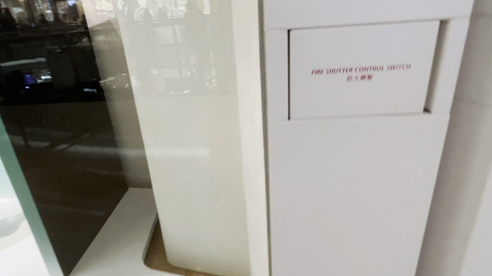
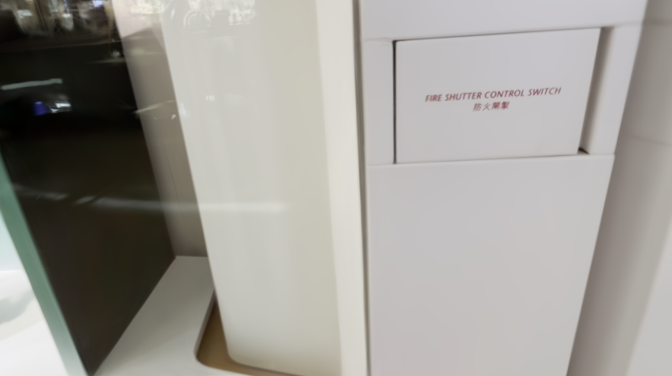
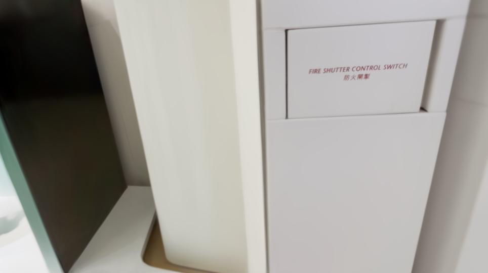
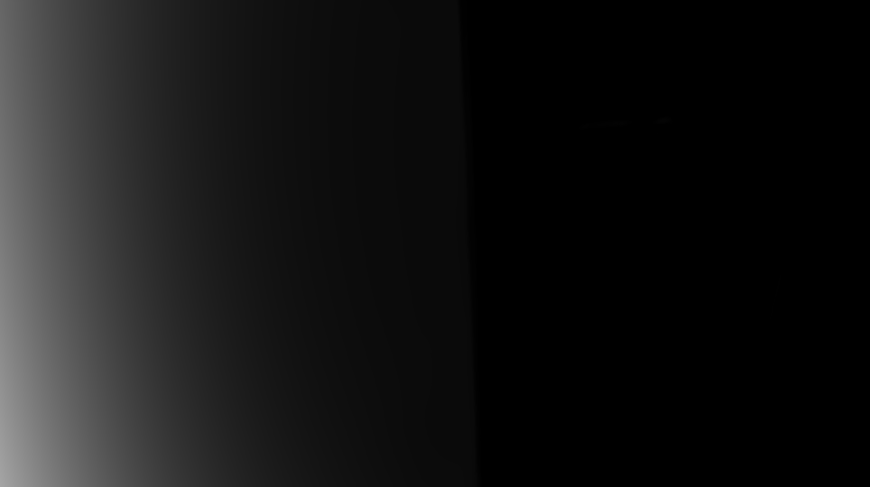
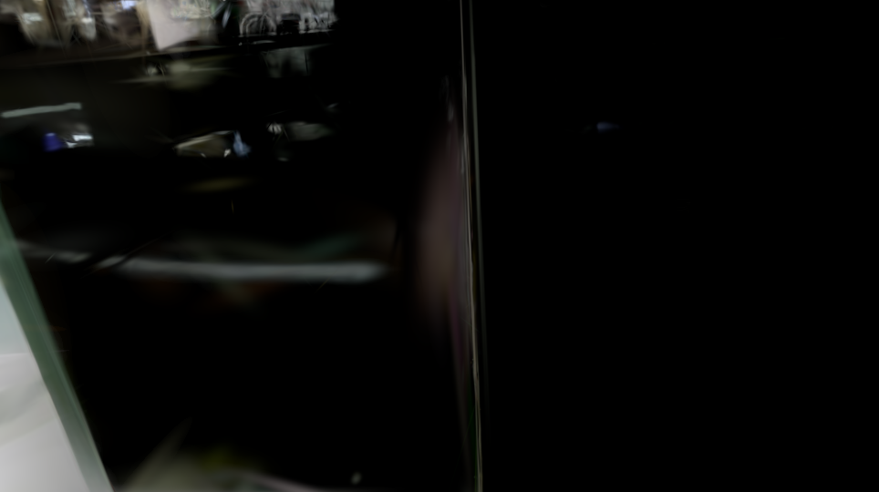
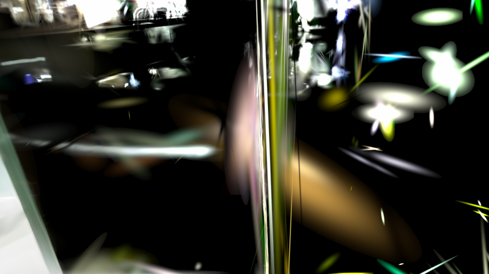
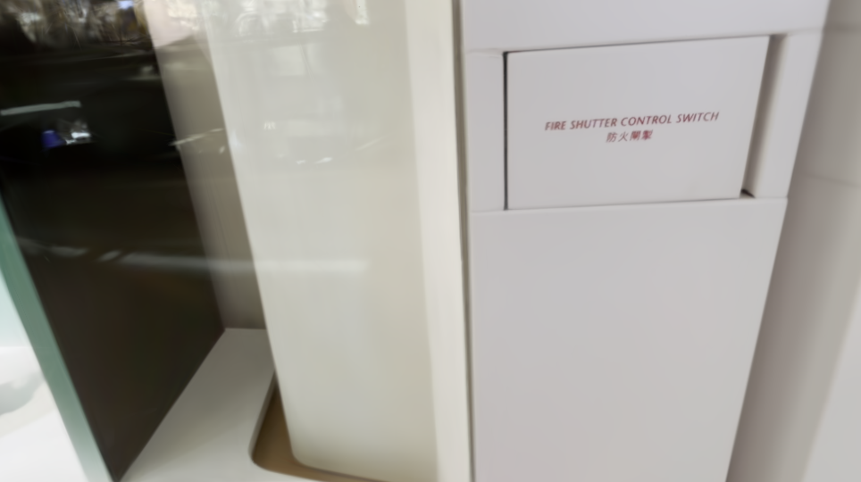
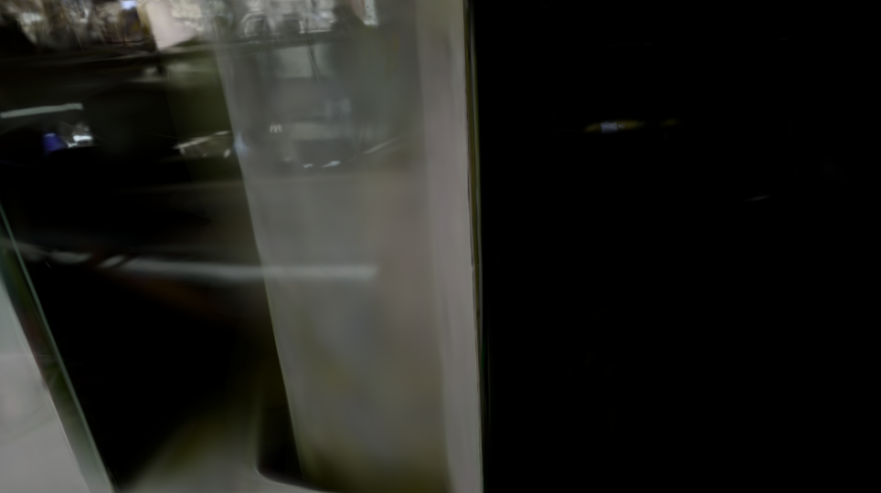

# VSGD 0758: Phân tích kết quả mô hình đầy đủ và 5 ablation

Lần chạy: Colab, ngày 18/11/2026, nhánh `viet_huynh`, notebook `notebooks/colab_vsgd_0758.ipynb`.
Kết quả gốc nằm trên Drive tại `vigor_gs_runs/VSGD_0758/`. Các số liệu và hình trích ra nằm trong `data/` và `figures/`.

---

## 0. Tóm tắt

1. **Mô hình đầy đủ đạt 33.09 dB PSNR (sRGB) trên 29 view test, nhưng không đứng đầu bảng.** Hai ablation cao hơn nó:
   - `no_separation` (một field duy nhất học thẳng trên ảnh gốc): 34.44 dB, hơn `full` ở 28/29 view.
   - `no_fresnel` (α là một hằng số học được): 34.12 dB, hơn `full` ở 28/29 view.

   Nếu chỉ dùng PSNR/SSIM/LPIPS trên ảnh tổng hợp, bảng ablation hiện tại **không ủng hộ** hai thành phần "tách trường phản chiếu" và "Fresnel".
2. **Camera ảo là thành phần đóng góp rõ nhất.** Bỏ nó đi thì mất 2.88 dB, thua `full` ở cả 29/29 view, và các view cuối chuỗi càng thua nhiều hơn.
3. **Factorization p·o có ích, nhưng tác dụng nằm ở hình học chứ không ở màu sắc.** Bỏ factorization thì PSNR Phase I còn cao hơn (33.21 so với 32.59), nhưng điểm kính bị kéo dài tới tận z = 72. Mặt phẳng kính tìm được lệch 44° so với mặt phẳng của `full` và chỉ có 8% inlier. Kết quả cuối kém 1.04 dB, thua ở 27/29 view.
4. **Giả định "kính là một mặt phẳng" bị vi phạm ở 0758.** Điểm kính phân bố trên ít nhất 3 hướng mặt phẳng lệch nhau 67–74°. Mặt phẳng được chọn chỉ chứa 17.7% số điểm, và 4% camera nằm sai phía mặt phẳng. Đây rất có thể là nguyên nhân chính khiến Fresnel và camera ảo chưa phát huy hết tác dụng.
5. **α theo Schlick quá nhỏ so với dữ liệu.** Hằng số mà `no_fresnel` học được là α = 0.242, gấp khoảng 6 lần F0 = 0.04 của Schlick (η = 1.5). Trong khi đó, ở `full` có 51% điểm ảnh kính có α < 0.1. Cái giá của `no_fresnel` là lớp phản chiếu bị **lẫn nội dung truyền qua kính** (hình 3), nên PSNR cao hơn nhưng việc tách lớp kém hơn.
6. **`shared_field` hiện là một ablation suy biến.** Nó chạy 0 iteration, PSNR sụt từ 27 dB ở view đầu xuống 16 dB ở view cuối, và kém cả việc không thêm phản chiếu. Không nên đưa vào bảng kết quả khi chưa thiết kế lại.
7. **Cần thêm chỉ số đánh giá việc tách lớp** (transmission so với ảnh clean, mức lẫn giữa các lớp). Nếu không có, bảng kết quả sẽ luôn có lợi cho baseline một field, vì baseline đó tối ưu trực tiếp đúng thứ được đo.

---

## 1. Thiết lập thí nghiệm

| Mục | Giá trị |
|---|---|
| Scene | VSGD `0758`: 146 khung hình, 117 train / 29 test (`split.json`) |
| Ảnh | `colmap/images`, `-r 2` cho ra 964×540; mask và ảnh clean đã undistort sang hệ COLMAP (sai lệch < 0.25 px) |
| Phase I | 30 000 iteration, deformation MLP 256×8, `--eval` |
| Phase II | 30 000 iteration, G_R khởi tạo với 100 000 điểm |
| Không gian màu | `linear_rgb=True` (mặc định); η_air = 1.0, η_glass = 1.5 |
| `optical_correction` (h_ψ) | **Tắt** (mặc định), nên α ở `full` là Schlick thuần |
| Mặt phẳng kính | RANSAC trên G_I (không truyền `--glass_plane`) |
| Seed | Một lần chạy cho mỗi biến thể |

Thời gian chạy trên GPU Colab:

| Bước | full | no_factorization | no_separation | no_virtual_camera | no_fresnel | shared_field |
|---|---|---|---|---|---|---|
| Phase I | 34 phút | 41 phút | 35 phút | (dùng lại của full) | (dùng lại của full) | (dùng lại của full) |
| Phase II | 15 phút | 10.5 phút | – | 16.5 phút | 15.5 phút | < 1 phút (0 iteration) |

Tổng thời gian khoảng 3 giờ 5 phút, tính cả lần `extract_plane` bị lỗi JSON và chạy lại (đã sửa ở commit `e20d954`).

Ba biến thể `no_virtual_camera`, `no_fresnel` và `shared_field` dùng chung Phase I và mặt phẳng kính của `full`. Vì vậy chênh lệch giữa chúng và `full` chỉ đến từ Phase II. Đây là một so sánh sạch.

---

## 2. Kết quả chính

Số liệu do `metrics.py` tính trên ảnh PNG 8-bit sRGB của 29 view test. Cột Δ là chênh lệch PSNR so với `full`, tính trung bình theo từng cặp view. Cột "thắng" là số view mà biến thể có PSNR cao hơn `full`.

| Biến thể | PSNR ↑ | SSIM ↑ | LPIPS ↓ | M-PSNR ↑ | M-SSIM ↑ | M-LPIPS ↓ | Δ PSNR | thắng | p (Wilcoxon) |
|---|---|---|---|---|---|---|---|---|---|
| **full** | 33.09 | 0.9390 | 0.2109 | 34.24 | 0.9690 | 0.0961 | – | – | – |
| (1) no_factorization | 32.05 | 0.9404 | 0.2041 | 32.71 | 0.9679 | 0.0967 | −1.04 | 2/29 | 6e-7 |
| (2a) no_separation | **34.44** | **0.9439** | **0.2001** | **35.62** | 0.9697 | 0.0958 | **+1.35** | 28/29 | 4e-6 |
| (2b) shared_field | 24.52 | 0.8928 | 0.2575 | 24.77 | 0.9231 | 0.1426 | −8.56 | 0/29 | 4e-9 |
| (3) no_virtual_camera | 30.21 | 0.9213 | 0.2423 | 30.82 | 0.9513 | 0.1274 | −2.88 | 0/29 | 4e-9 |
| (4) no_fresnel | 34.12 | 0.9406 | 0.2060 | 35.55 | **0.9706** | **0.0915** | +1.03 | 28/29 | 3e-6 |

Thứ hạng theo PSNR: `no_separation` > `no_fresnel` > **`full`** > `no_factorization` > `no_virtual_camera` >> `shared_field`.

Một chi tiết nhỏ: theo SSIM và LPIPS toàn ảnh, `no_factorization` cũng nhỉnh hơn `full` một chút (0.9404 so với 0.9390, 0.204 so với 0.211), dù PSNR thấp hơn 1 dB. Khác biệt này nhỏ và có thể đến từ vùng không phải kính.

### 2.1 Những điều cần lưu ý khi đọc số

**(a) PSNR trong log lúc train và PSNR của `metrics.py` là hai đại lượng khác nhau.** Log của `train_reflection.py` tính PSNR trong không gian *linear RGB* (vì `linear_rgb=True`), còn `metrics.py` tính trên PNG *sRGB*. Do đó hai bên lệch nhau từ 0.2 đến 1 dB, có khi theo chiều ngược nhau:

| | full | no_fact | no_vc | no_fresnel | shared |
|---|---|---|---|---|---|
| Log train (linear) | 32.26 | 31.13 | 29.40 | 33.58 | 25.53 |
| metrics.py (sRGB) | 33.09 | 32.05 | 30.21 | 34.12 | 24.52 |

Bài báo nên dùng số sRGB của `metrics.py` và ghi rõ không gian màu.

**(b) "Masked" PSNR/SSIM/LPIPS không phải là chỉ số tính riêng trong vùng kính.** `metrics.py` nhân cả ảnh render lẫn GT với mask rồi tính trên **toàn bộ ảnh**. Phần ngoài mask bằng 0 ở cả hai ảnh, nên MSE bị chia đều cho cả những pixel đó, và M-PSNR bị cộng thêm khoảng `10·log10(1/tỉ lệ mask)`. Kính chiếm khoảng 54% ảnh ở view 26, tương ứng khoảng +2.7 dB.

Từ M-PSNR và PSNR có thể suy ra **tỉ lệ sai số nằm trong vùng kính**: 77% ở `full`, 73% ở `no_fresnel`, 87% ở `no_virtual_camera`, 95% ở `shared_field`. Như vậy phần lớn sai số nằm ở kính, đúng như kỳ vọng.

Nên bổ sung một chỉ số PSNR chỉ tính MSE trên các pixel thuộc mask, để so sánh được với các bài khác.

**(c) Mức tin cậy thống kê.** Cả bảng chỉ có một scene và một seed. 29 view test lấy từ cùng một chuỗi video nên không độc lập với nhau. Giá trị p của Wilcoxon chỉ mang tính tham khảo. Tuy vậy, các chênh lệch như 28/29 hay 0/29 view là rất nhất quán, nên **chiều** của kết quả đáng tin. Độ lớn chính xác của từng Δ thì cần thêm seed và thêm scene.

---

## 3. Phân tích từng biến thể

### 3.1 Mô hình đầy đủ (`full`)

**Phase I** cho kết quả tốt:
- PSNR test so với ảnh clean tăng dần 31.91 → 32.16 → 32.59 dB (tại 7.5k / 15k / 30k iteration).
- glass IoU đạt 0.996.
- Train 33.18 so với test 32.59, tức overfit nhẹ.

Kết quả này cho thấy ảnh clean và mask sau khi undistort khớp tốt với ảnh COLMAP.

**Phần phản chiếu cần giải thích.** Nếu chỉ render interface (B, gọi là "direct only") rồi so với ảnh gốc, PSNR chỉ đạt 27.38 dB (linear). Phase II đưa con số này lên 32.26 dB (linear), tức **+4.9 dB** nhờ thành phần phản chiếu. Trong riêng vùng kính, mức tăng là 27.82 → 33.65.

Train (32.70) và test (32.26) gần nhau, nên G_R không overfit nhiều.

**Mặt phẳng kính có chất lượng kém** (`glass_plane.json`):
- n = [−0.638, 0.085, −0.765], d = 5.18.
- Inlier chỉ 17.7% với ngưỡng 0.068.
- Chỉ 95.7% camera nằm ở phía dương; 4% còn lại có camera ảo bị phản xạ ngược.
- Pipeline đã in cảnh báo `Fewer than half of the glass points lie on the fitted plane`. Xem mục 4.

**α theo Schlick nhỏ** (hình `figures/v26_full_alpha.png`). Thống kê trong vùng kính ở view 26:

| Chỉ số | Giá trị |
|---|---|
| Trung bình | 0.156 |
| Trung vị | 0.098 |
| Phân vị 10 | 0.039 |
| Phân vị 90 | 0.373 |
| Tỉ lệ pixel có α < 0.1 | 51% |

α chỉ lớn ở mép trái, nơi tia nhìn gần như song song với mặt phẳng. Ở phần giữa vùng kính, GT có phản chiếu rất mạnh (hình 1). Với α ≈ 0.05, G_R phải sáng gấp khoảng 20 lần nội dung thật mới tái tạo được, mà điều này không thể vì màu bị clamp về [0, 1]. Kết quả là phản chiếu trong ảnh render mờ và nhạt hơn GT.

**Đánh giá định tính** (hình 1 và 2):
- B (direct) sạch, không còn phản chiếu, chữ trên tủ sắc nét. Đây là thành công của Phase I.
- Ảnh tổng hợp có phản chiếu đúng vị trí nhưng mờ.
- Bóng người di chuyển trong phản chiếu (VSGD là video, có người qua lại) hầu như không được tái tạo.
- Khi render riêng G_R (`v26_full_reflection_raw.png`), có rất nhiều Gaussian hình kim và các đốm sáng ở vùng α ≈ 0. Chúng không ảnh hưởng tới ảnh tổng hợp vì bị α triệt tiêu, nhưng sẽ lộ ra nếu dùng lớp phản chiếu để chỉnh sửa hay trực quan hóa.

**PSNR tăng dần theo chỉ số view** (từ 32.58 ở nửa đầu lên 33.63 ở nửa sau, hệ số tương quan r = +0.62). View tệ nhất là 00000 (30.52 dB) và 00008 (30.63 dB).

### 3.2 (1) Bỏ factorization p·o (`no_factorization`)

| | full | no_factorization |
|---|---|---|
| PSNR Phase I (test, so với clean) | 32.59 | **33.21** |
| glass IoU | 0.996 | 0.996 |
| "direct only" so với ảnh gốc (linear) | 27.376 | 27.379 |
| Inlier của mặt phẳng | 17.7% | **8.1%** |
| Camera nằm phía trước mặt phẳng | 96% | 100% |
| Khoảng cách camera–mặt phẳng | 5.17 | 7.81 |
| Bounding box của điểm kính (z) | −2.6 … 11.4 | **2.7 … 72.6** |
| PSNR cuối (sRGB) | **33.09** | 32.05 |

Bảng này cho thấy hai điều:

- **Về màu sắc, factorization không giúp.** Thậm chí bỏ nó đi thì Phase I còn khớp ảnh clean tốt hơn 0.6 dB, và ảnh B so với ảnh gốc gần như giống hệt (27.376 so với 27.379).
- **Về hình học, factorization rất quan trọng.** Không có p·o, các Gaussian "kính" không định vị được ở bề mặt kính mà trôi theo độ sâu ra tới z ≈ 72. RANSAC khi đó chỉ khớp được một mặt phẳng gần như song song với mặt phẳng ảnh, lệch **44.3°** so với mặt phẳng của `full`. Chạy RANSAC tuần tự với 5 mặt phẳng cũng chỉ phủ được 31% số điểm, so với 58% ở `full`.

Vì B gần như giống hệt nhau, khoảng −1.04 dB ở kết quả cuối **đến từ mặt phẳng sai**: camera ảo và góc Fresnel đều sai theo. Kết quả cũng dao động mạnh giữa các view; ví dụ view 26 kém tới −3.4 dB.

**Kết luận:** ablation này ủng hộ vai trò của factorization, nhưng cần trình bày đúng cơ chế. Factorization giúp *định vị bề mặt kính* (và qua đó giúp Phase II), chứ không giúp tái tạo màu ở Phase I.

### 3.3 (2a) Không tách trường phản chiếu (`no_separation`)

Biến thể này huấn luyện một field duy nhất trên ảnh gốc (`--ignore_clean_images`) và render bằng `--direct_only`. Nó đạt **34.44 dB, cao nhất bảng**, hơn `full` ở 28/29 view, với Δ trung bình +1.35 dB (lớn nhất ở view 9–17, khoảng +2.5 dB).

Không nên đọc kết quả này là "tách lớp vô ích". Lý do nằm ở cách đo:

1. **Mục tiêu đánh giá chính là mục tiêu tối ưu của baseline.** Baseline tối ưu trực tiếp ảnh gốc, với toàn bộ capacity và không có ràng buộc vật lý nào. Field có deformation đủ mạnh để "nướng" phản chiếu vào màu phụ thuộc hướng nhìn và thời gian.
2. **`full` bị giới hạn bởi hai trần:**
   - B được cố định theo ảnh clean, là pseudo-GT do mạng xóa phản chiếu sinh ra. Ảnh clean này không nhất thiết nhất quán với ảnh gốc ngoài vùng phản chiếu, và B chỉ đạt 27.4 dB so với ảnh gốc.
   - α = Schlick quá nhỏ (mục 3.1), không đủ để G_R bù phần chênh lệch.
3. **Baseline không cho ra được lớp transmission hay lớp reflection.** Nó không làm được việc mà VIGOR-GS hướng tới: xóa phản chiếu, chỉnh sửa phản chiếu, hay render kính sạch.

**Hệ quả cho bài báo:** nếu bảng ablation chỉ có chỉ số trên ảnh tổng hợp, reviewer sẽ thấy ngay baseline tốt hơn. Cần thêm chỉ số đánh giá việc tách lớp; baseline sẽ thua ở đó (xem mục 6, đề xuất P1).

### 3.4 (2b) Không có G_R riêng (`shared_field`)

Theo thiết kế hiện tại, biến thể này dùng chính G_I (đã đóng băng) render qua camera ảo, trộn bằng Fresnel thuần, và không có tham số nào để học. Vì vậy nó chạy **0 iteration** và chỉ đánh giá.

Kết quả là 24.52 dB. Con số này **thấp hơn cả khi không thêm phản chiếu** (B so với ảnh gốc: 27.38 dB linear; ảnh tổng hợp chỉ 25.53 dB linear). PSNR giảm đều theo chỉ số view (r = −0.92), từ 27.1 dB ở view 0 xuống 16.4 dB ở view 28; ở nửa sau chuỗi, mức thua `full` lên tới −12 dB.

Nguyên nhân là phản chiếu thật đến từ không gian *phía sau camera* (lối đi, các cửa hàng đối diện), vùng mà G_I chưa từng quan sát. Phản xạ G_I qua mặt phẳng chỉ cho ra ảnh gương của chính tủ kính, nên thêm nội dung sai vào ảnh. Ở những view sau, kính chiếm nhiều diện tích hơn và nội dung sai càng lộ rõ.

**Kết luận:** biến thể này là một "strawman" và không đo được điều câu hỏi ablation muốn hỏi ("có cần một field phản chiếu riêng không?"). Đề xuất thiết kế lại ở mục 6, P4.

### 3.5 (3) Bỏ camera ảo (`no_virtual_camera`)

Ở biến thể này G_R được render từ camera thật thay vì camera phản xạ qua Π. Kết quả là −2.88 dB, **thua ở cả 29/29 view**; LPIPS tăng từ 0.211 lên 0.242.

Mức thua lớn dần theo view: −1.96 dB ở nửa đầu và −3.88 dB ở nửa sau. Nói cách khác, khi camera di chuyển xa hơn, một G_R "dán" ở không gian thật không thể mô phỏng được thị sai của ảnh ảo. Phase II của biến thể này chỉ tăng được +2.0 dB (linear) so với direct only, trong khi `full` tăng +4.9 dB.

**Kết luận:** đây là ablation sạch nhất (cùng Phase I, cùng mặt phẳng) và ủng hộ mạnh nhất cho phương pháp. Đáng chú ý là kết quả này đạt được **dù mặt phẳng ước lượng còn kém**. Nếu mặt phẳng tốt hơn, khoảng cách có thể còn lớn hơn.

### 3.6 (4) Bỏ Fresnel (`no_fresnel`)

Ở biến thể này α là một hằng số học được (`--ablate_fresnel`). Kết quả là 34.12 dB, **cao hơn `full` 1.03 dB**, thắng 28/29 view, và có M-SSIM, M-LPIPS tốt nhất bảng.

Đọc `reflection/blend/iteration_30000/blend.pth` thì thấy hằng số học được là **α = sigmoid(−1.142) = 0.242**, trong khi Schlick cho F0 = ((1.5−1)/(1.5+1))² = 0.04. Dữ liệu "muốn" phản chiếu mạnh gấp khoảng 6 lần ở góc nhìn vuông góc. Các nguyên nhân có thể (chưa kiểm chứng riêng từng cái):

- **Mặt phẳng sai** (mục 4) làm cos θ sai, nên Schlick sai.
- **Kính thật không phải một tấm η = 1.5 sạch.** Có thể có hai mặt kính, kính hai lớp, hay lớp phủ. Kính nhiều mặt sẽ có tổng phản xạ cao hơn.
- **Ảnh clean làm nhiều hơn việc xóa phản chiếu**, ví dụ làm sáng hoặc khử sương mờ. Khi đó (1−α)·B cần một α lớn để làm tối B về đúng mức của ảnh gốc.
- **Khác biệt sRGB/linear trong ảnh clean**, nếu mạng sinh ảnh clean làm việc trong sRGB.

**Cái giá của PSNR cao hơn** (hình 3, `v26_no_fresnel_reflection_contribution.png`): lớp α·R của `no_fresnel` chứa **bản sao cái tủ trắng**, vốn là vật nằm sau kính. Vì α = 0.24 làm tối B đi 24% trên toàn bộ vùng kính, G_R phải "vẽ lại" một phần transmission để bù vào. Đây là hiện tượng **lẫn transmission sang reflection**, tức tách lớp kém hơn hẳn `full`, dù ảnh tổng hợp đẹp hơn.

**Kết luận:** chỉ số trên ảnh tổng hợp không phân biệt được hai trường hợp này. Đồng thời kết quả cho thấy Schlick với η = 1.5 và không có h_ψ quá cứng cho dữ liệu thật. Lần chạy này đặt `optical_correction=False`, tức số hạng hiệu chỉnh h_ψ trong công thức α = clip(F(θ) + h_ψ) **chưa được dùng**. "Full" hiện tại thực ra chưa đầy đủ theo spec.

---

## 4. Hình học kính: một mặt phẳng là không đủ

Mình chạy RANSAC tuần tự (ngưỡng 0.068, cùng ngưỡng với `extract_plane.py`) trên `glass_points.ply` (234 000 điểm từ 117 view) của `full`:

| Mặt phẳng | Pháp tuyến n | d | Tỉ lệ điểm | Góc so với mặt 0 |
|---|---|---|---|---|
| 0 (đang được dùng) | [−0.64, 0.08, −0.77] | 5.18 | 17.8% | – |
| 1 | [0.56, −0.06, −0.83] | 3.93 | 15.0% | ≈ 74° |
| 2 | [0.96, −0.03, −0.29] | 4.58 | 11.9% | ≈ 67° |
| 3 | [−0.59, 0.21, −0.78] | 5.56 | 7.8% | ≈ 8° (song song mặt 0, lệch 0.4) |
| 4 | [0.30, 0.89, −0.34] | 2.35 | 5.9% | – |
| 5 mặt cộng lại | | | 58.4% | |

Trung vị khoảng cách từ điểm kính tới mặt phẳng 0 là 0.61, gấp 9 lần ngưỡng.

Các số này khớp với hình ảnh: 0758 là một tủ/vách kính ở góc, có ít nhất mặt trước và mặt bên (cạnh kính xanh ở mép trái ảnh). Ba hướng lệch nhau 67–74° là dấu hiệu của **nhiều tấm kính**, không phải nhiễu. Còn mặt 3, song song mặt 0 và lệch 0.4, có thể là mặt sau của cùng tủ hoặc lớp kính thứ hai.

Hệ quả:
- Camera ảo chỉ đúng cho những pixel thuộc tấm kính khớp với mặt 0.
- Với các tấm khác, cả hình học phản xạ lẫn góc Fresnel đều sai.
- 4% camera nằm phía sau mặt phẳng, nên camera ảo của chúng bị lật.

Đây là cùng vấn đề đã gặp ở `3D-FRONT-T/scene_1` (tủ kính nhiều mặt), lúc đó đã quyết định tạm để nguyên. Với 0758, nó ảnh hưởng trực tiếp tới hai ablation Fresnel và camera ảo.

---

## 5. Kết quả này ủng hộ và chưa ủng hộ những gì

| Thành phần | Kết quả trên 0758 | Mức tin cậy | Ghi chú |
|---|---|---|---|
| Camera ảo | Ủng hộ mạnh: +2.88 dB, 29/29 view | Cao (cùng Phase I) | Dù mặt phẳng còn kém |
| Factorization p·o | Ủng hộ: +1.04 dB, 27/29 view | Trung bình | Cơ chế là hình học/mặt phẳng, không phải màu |
| Fresnel (Schlick, không có h_ψ) | **Ngược chiều**: −1.03 dB | Cao về chiều | Nhưng `no_fresnel` lẫn transmission; cần chỉ số tách lớp |
| Tách trường / dùng ảnh clean | **Ngược chiều** trên ảnh tổng hợp: −1.35 dB | Cao về chiều | Baseline không tách được lớp; cần chỉ số tách lớp |
| G_R riêng | Chưa kết luận được | – | `shared_field` suy biến (0 iteration) |

---

## 6. Đề xuất, xếp theo độ ưu tiên

**P1. Bổ sung đánh giá việc tách lớp.** Đây là việc quan trọng nhất, và chỉ cần sửa code đánh giá, không phải train lại.
- **Transmission PSNR/SSIM/LPIPS**: so B với ảnh clean trên các view test (ảnh clean có cho cả split test). `full` đã đạt 32.59 dB. `no_separation` được đánh giá theo cùng cách sẽ thấp hơn nhiều, vì nó chứa cả phản chiếu.
- **Mức lẫn transmission sang reflection**: ví dụ tương quan giữa α·R và B trong vùng kính, hoặc năng lượng của α·R ở những nơi ảnh clean có cạnh mạnh. Chỉ số này sẽ bắt được lỗi của `no_fresnel`.
- **Masked PSNR đúng nghĩa**: MSE chỉ tính trên các pixel thuộc mask (giữ chỉ số cũ nếu cần so sánh với code gốc).
- Ghi rõ không gian màu (sRGB) trong bảng.

**P2. Chạy lại `full` với `--optical_correction`.** h_ψ thuộc spec của α. Cần kiểm tra:
- `lambda_opt = 0.01` có ép h_ψ quá mạnh không, khi dữ liệu cần α tăng khoảng +0.2.
- Có thể thử thêm biến thể học F0 (hoặc η) cho từng scene.

Chi phí khoảng 15 phút, vì dùng lại được Phase I.

**P3. Xử lý mặt phẳng kính cho 0758.** Có ba lựa chọn, từ rẻ đến đắt:
- (a) Chọn mặt phẳng thủ công bằng `--glass_plane`, chọn đúng tấm chiếm nhiều diện tích nhất trong các view test, và kiểm tra lại số camera nằm phía trước.
- (b) Fit mặt phẳng trên những điểm có độ tin cậy cao hơn (lọc theo p·o, hoặc theo từng thành phần liên thông của mask).
- (c) Mở rộng sang nhiều mặt phẳng: RANSAC tuần tự, gán mỗi pixel vào một mặt, mỗi mặt có camera ảo riêng.

Lựa chọn (c) đã từng được đề xuất cho 3D-FRONT-T và bạn quyết định tạm hoãn. Kết quả 0758 là lý do để cân nhắc lại.

**P4. Thiết kế lại `shared_field`.** Hai hướng:
- (a) Cho G_I tiếp tục được fine-tune ở Phase II, để nó vừa giải thích B vừa giải thích R qua camera ảo, tức "một field cho cả hai".
- (b) Bỏ biến thể này khỏi bảng và chỉ giữ (2a).

Thiết kế hiện tại không học gì, nên kết quả gần như chắc chắn thua.

**P5. Độ tin cậy thống kê.** Chạy ít nhất 3 seed cho `full`, `no_fresnel` và `no_separation`, vì đây là các cặp có chênh lệch khoảng 1 dB. Mở rộng sang các scene VSGD khác khi đã có ảnh clean. Báo cáo theo cặp view (Δ, số view thắng) thay vì chỉ trung bình.

**P6. Làm sạch G_R ngoài vùng kính.** Đây là việc không bắt buộc, chỉ phục vụ việc trực quan hóa lớp phản chiếu. Có thể chỉ tính gradient hoặc densify G_R trong vùng có α·glass_map > ε, hoặc thêm regularizer cho scale/opacity để loại các Gaussian hình kim.

---

## 7. Hình minh họa (view test 00026)

| | |
|---|---|
| Hình 1a: GT `figures/v26_gt.png` | Hình 1b: `full` render `figures/v26_full_render.png` |
| Hình 1c: `full` B (direct) `figures/v26_full_direct.png` | Hình 1d: mask kính `figures/v26_glass_mask.png` |
| Hình 2a: `full` α `figures/v26_full_alpha.png` | Hình 2b: `full` α·R `figures/v26_full_reflection_contribution.png` |
| Hình 2c: `full` R thô `figures/v26_full_reflection_raw.png` | |
| Hình 3a: `no_fresnel` render `figures/v26_no_fresnel_render.png` | Hình 3b: `no_fresnel` α·R `figures/v26_no_fresnel_reflection_contribution.png` (có bản sao tủ trắng) |

---

## Phụ lục A: Diễn biến trong lúc train (PSNR linear RGB, log của Colab)

Phase I (test, so với ảnh clean; riêng `no_separation` so với ảnh gốc):

| Iteration | full | no_factorization | no_separation |
|---|---|---|---|
| 7 500 | 31.91 | 32.24 | 32.52 |
| 15 000 | 32.16 | 32.79 | 33.36 |
| 30 000 | 32.59 | 33.21 | 34.22 |
| glass IoU @30k | 0.996 | 0.996 | 0.996 |

Phase II (test, ảnh tổng hợp so với ảnh gốc; "direct only" ≈ 27.38):

| Iteration | full | no_factorization | no_virtual_camera | no_fresnel | shared_field |
|---|---|---|---|---|---|
| 0 | – | – | – | – | 25.53 |
| 7 500 | 31.21 | 30.27 | 28.98 | 32.24 | – |
| 15 000 | 32.00 | 30.88 | 29.21 | 33.16 | – |
| 30 000 | 32.26 | 31.13 | 29.40 | 33.58 | – |

Mọi biến thể vẫn còn tăng nhẹ giữa 15k và 30k: `full` +0.26, `no_fresnel` +0.41. Train thêm có thể nhích thêm một chút nhưng sẽ không đổi thứ hạng.

## Phụ lục B: Dữ liệu

- `data/summary.csv`: bảng chính, giống `summary.csv` trên Drive.
- `data/per_view_psnr.csv`: PSNR và Masked PSNR của từng view test cho 6 biến thể.
- Mặt phẳng kính: `full` / `no_virtual_camera` / `no_fresnel` / `shared_field` dùng chung mặt phẳng n = [−0.6385, 0.0849, −0.7649], d = 5.1770. `no_factorization` dùng n = [−0.0087, −0.2806, −0.9598], d = 7.7770.
- Hằng số α đã học của `no_fresnel`: logit −1.1423, tương ứng α = 0.2419.
